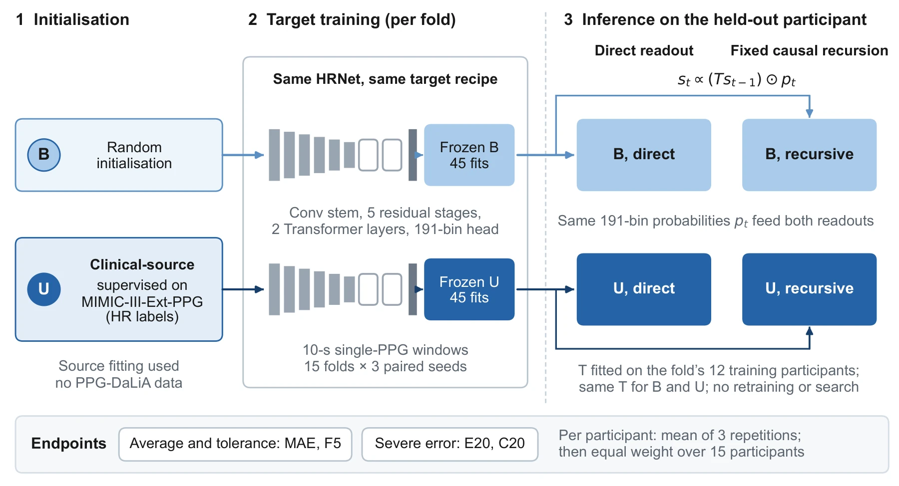
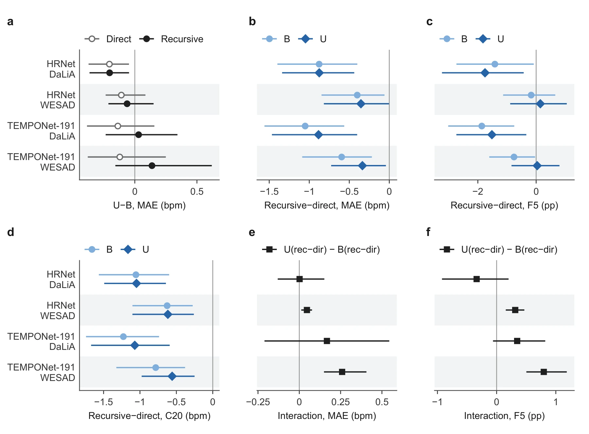
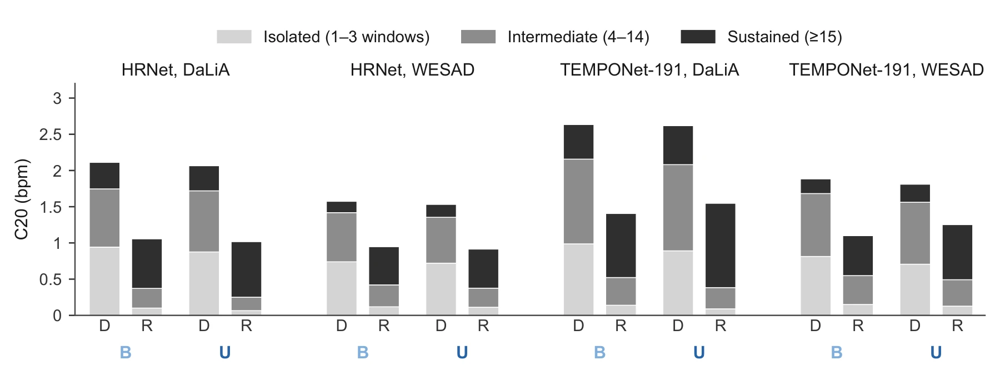

<h1 align="center"> Initialisation × Inference</h1>

<p align="center"><strong>Clinical-source initialisation and causal temporal inference for wrist-PPG heart-rate estimation</strong><br><sub>A paired evaluation across two datasets and two networks</sub></p>

<p align="center"><a href="https://orcid.org/0009-0002-4046-7302">Xianjin Lin</a><sup>1</sup> · <a href="https://orcid.org/0000-0003-2353-8615">Liyang Yu</a><sup>1*</sup> · Zhonglou Luo<sup>1</sup> · Rui Tian<sup>1</sup> · <a href="https://orcid.org/0000-0001-8932-6792">Wangcai Ding</a><sup>2,3</sup><br><sub><sup>1</sup>Qinghai University · <sup>2</sup>Lanzhou Jiaotong University · <sup>3</sup>Xi'an Traffic Engineering Institute · * Corresponding author</sub></p>

<p align="center"><a href="https://xianjin-lin.github.io/ppg-initialisation-inference/"><strong>Project&nbsp;page</strong></a> · <a href="#paired-design">Design</a> · <a href="#key-evidence">Key&nbsp;evidence</a> · <a href="#severe-error-duration-exploratory">Duration</a> · <a href="#what-the-project-page-contains">Page&nbsp;guide</a><br><a href="#what-is-and-is-not-released">Released&nbsp;material</a> · <a href="#datasets">Datasets</a> · <a href="#citation">Citation</a></p>

<p align="center"><code>Manuscript in preparation</code> · <code>Aggregate results only</code> · <code>Static site, no build step</code></p>

<table align="center">
<tr>
<td><a href="https://xianjin-lin.github.io/ppg-initialisation-inference/"></a></td>
<td><strong>Interactive project page.</strong><br>Explore all 80 stored aggregate estimates, the<br>severe-error duration split and a<br>synthetic recursion lab.</td>
</tr>
</table>

<blockquote>
<p><sub><strong>Summary.</strong> Clinical-source initialisation and causal temporal inference act at different stages of wrist photoplethysmography (PPG) heart-rate estimation, so their effects can be confounded unless they are compared under matched conditions. HRNet and TEMPONet-191 were fitted on PPG-DaLiA from random (B) or clinical-source (U) initialisation and read out directly and through a fixed causal recursion adapted from BeliefPPG, on DaLiA and on 15 evaluation-only WESAD participants. Recursion reduced mean MAE and C20 under both initialisations in all four network–dataset settings, but on WESAD it reduced MAE less under U than under B for both networks. This repository hosts the static companion page: stored aggregate results and three manuscript figures, not models, predictions or participant-level data.</sub></p>
</blockquote>

## Paired design

Initialisation is chosen when a network is trained; the recursion is applied afterwards, to the frozen network's outputs. Crossing the two choices on identical windows gives a 2 × 2 within each setting:

| | Direct readout | Fixed causal recursion |
|---|---|---|
| **B** · random initialisation | B, direct | B, recursive |
| **U** · clinical-source initialisation | U, direct | U, recursive |



<sub>Paired design (manuscript Fig. 1). U starts from supervised heart-rate training on clinical PPG (MIMIC-III-Ext-PPG, no PPG-DaLiA data). Both initialisations then follow the same target recipe in 15 participant-separated folds × 3 paired repetitions. After training, no parameter is retrained or searched. The recursion's transition matrix is fitted on each fold's training participants and shared by B and U. The network glyph is schematic.</sub>

The design was repeated for two networks (HRNet, TEMPONet-191) and two datasets (PPG-DaLiA, WESAD), giving **four settings**. WESAD was used for evaluation only, with the same wrist device model as DaLiA, so it is not a cross-device test. Both networks share the 15 evaluated participants of each dataset, so the four settings are not independent replications and do not amount to 60 people.

| Endpoint | Definition |
|---|---|
| MAE | Mean absolute error (bpm) |
| F5 | Percentage of windows with absolute error above 5 bpm; differences in percentage points (pp) |
| E20 | Mean positive excess above 20 bpm, mean of max(0, absolute error − 20) (bpm) |
| C20 | Contribution of errors above 20 bpm to MAE, mean of absolute error × 1(absolute error > 20) over all windows (bpm); not a percentage |

Repetitions are averaged within each participant first, and participants are then weighted equally. The 5- and 20-bpm thresholds are analysis definitions, not clinical safety criteria.

## Key evidence



<sub>Initialisation, recursion and interaction contrasts across four settings (manuscript Fig. 6). Points are participant-equal means; whiskers are stored descriptive 95% participant-bootstrap percentile intervals. The interaction intervals in (e, f) are their own stored paired intervals and were never formed from the separate B and U intervals.</sub>

**Initialisation (panel a).** For HRNet on DaLiA, U lowered participant-averaged MAE by 0.204 and 0.203 bpm under direct and recursive readout (intervals 0.047–0.372 and 0.046–0.364 bpm). In the other three settings all U − B MAE intervals included zero, so a consistent average-error advantage of U was not established beyond HRNet on DaLiA.

**Recursion (panels b–d).** Recursion reduced mean MAE and C20 under both initialisations in all four settings, and every corresponding interval lay below zero. Averages hide exceptions: on WESAD, recursion increased MAE in two to seven of 15 participants and F5 in up to ten.

**Interaction (panels e, f).** On WESAD, recursion reduced MAE less under U than under B for both networks: +0.046 bpm [+0.012, +0.077] for HRNet and +0.259 bpm [+0.149, +0.406] for TEMPONet-191. The corresponding TEMPONet-191 interval on DaLiA included zero.

<details>
<summary><strong>How to read the intervals and signs</strong></summary>

- Intervals are descriptive participant-bootstrap percentile intervals (10,000 paired resamples), conditional on the evaluated fits. They are not significance tests, and an interval that includes zero is not evidence of no effect or of equivalence.
- For U − B, negative values mean lower values under U. For recursive − direct, negative values mean lower values under recursion.
- The interaction is (U<sub>rec</sub> − U<sub>dir</sub>) − (B<sub>rec</sub> − B<sub>dir</sub>). A positive value means the recursive-minus-direct change was more positive under U than under B (a smaller reduction or a larger increase). By itself it does not say whether either effect is an improvement.
- No test was made of whether an effect differs between settings or datasets.

</details>

## Severe-error duration (exploratory)



<sub>C20 composition by severe-error duration (manuscript Fig. 8). Runs of windows with error above 20 bpm are classed as isolated (1–3), intermediate (4–14) or sustained (≥ 15). Bars are participant-equal means, and each stack sums to that readout's C20.</sub>

Recursion lowered the contribution of isolated severe errors in every participant and setting, while the average contribution of sustained severe errors rose. Runs were classified separately under each readout, so the bars show how C20 is redistributed among duration classes. They do not follow individual errors, and they cannot separate prolonged, merged, reclassified or newly created errors. The prespecified summary rule was not met in any setting because too few participants had sustained runs under direct readout. HRNet analyses followed a frozen plan; the TEMPONet-191 applications were additional analyses.

## What the project page contains

| Section | Content | Source |
|---|---|---|
| Design | Interactive version of the 2 × 2 and the endpoint definitions | Manuscript |
| Evidence | Filterable explorer of all 80 stored aggregate estimates (4 settings × 5 contrasts × 4 endpoints), with CSV download | Stored results |
| Participants | Group means and counts of participants whose values rose or fell; per-participant rows are held pending release approval | Stored results |
| Duration | Interactive C20 duration stacks | Stored results, exploratory |
| Recursion lab | Browser-generated toy sequence showing the causal update | **Synthetic**, not participant data |
| Figures and provenance | Web renderings of Figs. 1, 6 and 8, and the origin of every number | Manuscript |

The page only explains results reported in the manuscript and adds no new analysis. No trained model is run in the browser. Real-evidence views read stored aggregate values from the repository's data files; the recursion lab computes only a synthetic illustration. The 80 contrast estimates and their intervals are also available as CSV ([`data/evidence_aggregate.csv`](data/evidence_aggregate.csv)).

## What is and is not released

| Component | Available here |
|---|---|
| Aggregate results | 80 stored participant-equal means with descriptive 95% intervals (`data/evidence_aggregate.csv`) |
| Figures | Web renderings of manuscript Figs. 1, 6 and 8 (review-candidate numbering, may change) |
| Project page | Static HTML, CSS and JavaScript with no external runtime dependency |

**Not released:** training, inference and analysis code; checkpoints and prediction caches; per-participant or per-window values; raw or processed PPG and ECG recordings. No future release of these components is promised.

<details>
<summary><strong>Repository map</strong></summary>

```text
index.html                    Project page entry point (GitHub Pages)
app.js                        Real-evidence views; reads stored aggregates only
lab.js, lab-core.js           Synthetic recursion lab (toy data generated in the browser)
styles.css                    Page styles, light and dark themes
data/evidence_aggregate.csv   80 stored aggregate estimates, full precision
data/*.js                     Aggregate values, figure metadata, provenance and site settings
assets/figures/               Web renderings of manuscript figures
assets/                       Favicon and social preview image
```

</details>

## Datasets

This repository redistributes no dataset. Each dataset is governed by its provider's terms.

| Dataset | Role in the study | Reference |
|---|---|---|
| [MIMIC-III-Ext-PPG](https://physionet.org/content/mimic-iii-ext-ppg/1.1.0/) v1.1.0 | Clinical source for U initialisation | [doi:10.13026/r6k1-xt76](https://doi.org/10.13026/r6k1-xt76) |
| [PPG-DaLiA](https://archive.ics.uci.edu/dataset/495/ppg+dalia) | Target training and evaluation (15 participant-separated folds) | Reiss et al., 2019, [doi:10.3390/s19143079](https://doi.org/10.3390/s19143079) |
| [WESAD](https://archive.ics.uci.edu/dataset/465/wesad+wearable+stress+and+affect+detection) | Evaluation only (15 participants) | Schmidt et al., 2018, [doi:10.1145/3242969.3242985](https://doi.org/10.1145/3242969.3242985) |

WESAD identifiers follow WESAD numbering. Equal labels do not identify the same person across the two datasets, and participant overlap between them is unverified.

## Citation

**Manuscript:** *Clinical-source initialisation and causal temporal inference for wrist-PPG heart-rate estimation: a paired evaluation across two datasets and two networks.* The manuscript is in preparation; there is no DOI, preprint or published version yet. Values and figures follow the current review candidate and may change before publication.

When using the datasets, please cite the original providers listed above.

## Rights and responsible use

No LICENSE file is included, so no open-source licence is granted for the published material. This is a research companion, not a medical device, diagnostic tool or validated real-time monitoring system. It makes no claim of live wearable deployment, clinical safety or alarm performance.

The page was built with AI-assisted coding and checking under the authors' direction; scientific statements are taken from the manuscript and the stored results.
